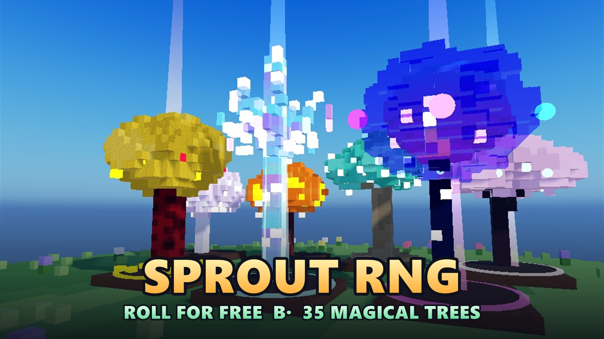
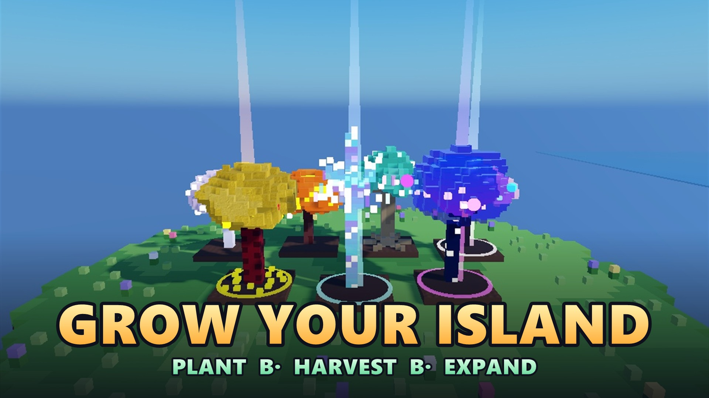
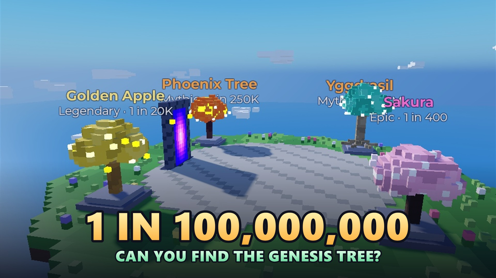

# Garden RNG Dungeon

Roblox-игра про воксельный сад на летающем острове. Бесплатная крутилка выдаёт деревья, они растут и приносят монеты, а в подземелье можно добыть оружие и ценную добычу. Играть можно с телефона, интерфейс сделан под короткие сессии.



## Как играть

1. **Крути.** Крутка бесплатная, ограничена только откатом. Игрок видит шанс каждого дерева числом, сумма всегда 100%.
2. **Сажай.** У каждого свой остров с грядками. Дерево растёт по времени сервера, в том числе когда игрока нет в игре.
3. **Собирай монеты.** Урожай даёт монеты, а редкие деревья дают больше. При созревании дерево может получить мутацию (Giant, Golden, Rainbow).
4. **Расширяй остров** за время в игре, монеты и ростки.
5. **Ходи в подземелье.** Пять волн врагов, в последней босс. Из них выпадает добыча на продажу и оружие.



## Что есть в игре

- **35 видов деревьев** в 7 редкостях от Common до Divine. Самые редкие выпадают примерно раз из 100 миллионов круток.
- **Удача** растёт от числа круток, улучшений за монеты и коллекции. Каждая 10-я крутка счастливая.
- **Подземелье:** слизни, скелеты и босс в пятой волне. После смерти теряется часть добычи, остальное сохраняется, один бесплатный реквив за забег.
- **20 видов воксельного оружия** в 5 уровнях редкости: мечи, топоры, кинжалы, посохи, копья, молоты, катана, коса. У 12 из них есть свечение, частицы и след удара. У каждого типа свои боевые анимации.
- **Звук:** амбиент острова и подземелья, у каждого дерева своя мелодия выпадения, звуки врагов и оружия.
- **Интерфейс для телефона:** крупные кнопки, три главных экрана (Сад, Крутилка, Подземелье), кнопка скрытия интерфейса, настройки громкости.



## Честная монетизация

- **Платного рандома нет.** За Robux продаются только вещи с известным заранее результатом: 5 эксклюзивных деревьев, ×2 монет, авто-сбор, дополнительные грядки.
- Удача и шансы за Robux не продаются, оружие тоже.
- Все цены видны сразу, нет таймеров «последний шанс» и всплывающих предложений посреди игры.
- Бесплатный игрок проходит всю игру, всё платное только ускоряет и украшает.

Подробности: [Магазин Robux.md](Магазин%20Robux.md).

## Для разработчиков

Игра собирается из файлов через [Rojo](https://rojo.space): код живёт в `src/`, а карта и расстановка острова хранятся в самом месте в Roblox Studio.

### Запуск

1. Установи инструменты (Rojo, StyLua, Selene) через [Rokit](https://github.com/rojo-rbx/rokit):

   ```bash
   rokit install
   ```

2. Запусти сервер синхронизации:

   ```bash
   rojo serve
   ```

3. Открой место **Garden RNG Dungeon** в Roblox Studio, в плагине Rojo нажми **Connect**.
4. Для проверки кода после правок:

   ```bash
   stylua src
   selene src
   ```

Скрипты правятся только в файлах, а не в Studio: иначе Rojo перезапишет правки.

### Структура

| Папка | Куда попадает в игре | Что внутри |
|---|---|---|
| `src/shared` | ReplicatedStorage.Shared | Конфиги баланса (`Config/`), формулы удачи и сада, список удалённых вызовов |
| `src/server` | ServerScriptService.Server | Сервисы: данные игрока, крутка, сад, подземелье, магазин, постройка деревьев и оружия |
| `src/client` | StarterPlayerScripts.Client | Интерфейс, эффекты, звук, анимации ударов |
| `assets` | не загружается | Иконки и маркетинговые картинки |
| `tools` | не загружается | Симулятор баланса, генераторы иконок и обложек |

### Правила кода

- Всё важное считается **на сервере**: крутки, мутации, награды, покупки, монеты. Клиент только показывает результат и шлёт запросы.
- Каждый удалённый вызов проверяется на сервере: тип, диапазон, частота запросов.
- Числа баланса лежат только в `src/shared/Config/`, шансы крутки в `Config/Rarities.luau`.
- В каждом файле Luau стоит `--!strict`.

Полный список правил: [CLAUDE.md](CLAUDE.md).

## Документы

| Файл | О чём |
|---|---|
| [Roadmap](Сад%20RNG%20Dungeon%20Survival%20%28Roblox%29%20—%20Roadmap.md) | Идея игры и план, главный источник по геймдизайну |
| [Баланс и прогрессия.md](Баланс%20и%20прогрессия.md) | Шансы, доход деревьев, расширение острова, добыча |
| [Визуал и экономика растений.md](Визуал%20и%20экономика%20растений.md) | Как выглядят деревья и как считается экономика |
| [Магазин Robux.md](Магазин%20Robux.md) | Что продаётся и как включить продажи |
| [Публикация — чек-лист.md](Публикация%20—%20чек-лист.md) | Шаги для выпуска игры |
| [Видео — как записать.md](Видео%20—%20как%20записать.md) | Как снять трейлер игры |
| [Иконки — как добавить.md](Иконки%20—%20как%20добавить.md) | Как заменить иконки интерфейса |
| [Архив идей.md](Архив%20идей.md) | Идеи, которые пока не в плане |
| [Рекомендации — Claude + Roblox Studio.md](Рекомендации%20—%20Claude%20+%20Roblox%20Studio.md) | Как работать с Claude в Studio |

## Состояние проекта

Игра опубликована, работает полный цикл: крутилка, остров, подземелье, оружие, магазин. Продажи в магазине включатся, когда владелец создаст пропуски в Creator Hub и впишет их ID в `src/shared/Config/init.luau`: до этого кнопки показывают «Soon».

Лицензия не указана.
